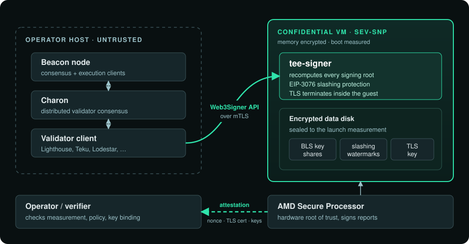

<h1 align="center">SEV Signer<br/>A Web3Signer-compatible remote signer for confidential VMs</h1>

<p align="center">
<a href="https://github.com/ObolNetwork/sev-signer/actions/workflows/signer.yml"></a>
<a href="LICENSE"></a>

</p>

This repo holds a BLS remote signer for [Obol](https://obol.org) [distributed validators](https://docs.obol.org/docs/int/key-concepts).
The signer is built to run inside a confidential VM. On AMD SEV-SNP, the host that runs the VM can't read
the key shares or use the signer to produce slashable signatures. It also holds tooling to build that guest
image. Intel TDX and Arm CCA support is planned.

The validator client talks to the signer through the standard [Web3Signer](https://docs.web3signer.consensys.io/)
API, so Lighthouse, Teku, Lodestar and the other validator clients work unchanged. Before trusting a signer,
an operator asks the hardware for an attestation report. The report proves which software is running and
binds the TLS key and validator keys to it.



> [!WARNING]
> **Experimental. Not for mainnet keys.** Published early so other TEE signer projects can compare designs.
> * The signer has been tested against independent test vectors, but it has not yet run on SEV-SNP hardware
>   or been driven end to end by a validator client or charon cluster.
> * The guest image in [`vm-scripts/`](vm-scripts/) is an early prototype and is **not safe for keys** as built.
>   Its replacement, a mkosi image in [`image/`](image/), is written but not yet built or booted.
> * It is unaudited.
>
> See [ROADMAP.md](ROADMAP.md) for the full assessment, [known gaps](ROADMAP.md#known-gaps) and the path to production.

## How it works

| | |
|---|---|
| **Signs only what it can verify** | Every signing root is recomputed from the typed request, with the domain chosen by request type. The signer never signs a 32-byte root supplied by the client, so a compromised validator client can't use it as a signing oracle. |
| **Slashing protection inside the TEE** | Keeps EIP-3076 watermarks per key and writes them to disk before releasing a signature. Interchange files can be imported and exported. |
| **Keys stay in the guest** | Run `charon dkg` inside the VM, and key shares are created on its encrypted disk. They are never exported. If a node is lost, the cluster replaces it with `charon edit replace-operator`. |
| **Attested TLS** | TLS terminates inside the guest. `GET /api/v1/tee/attestation?nonce=…` returns a hardware report whose REPORT_DATA commits to the nonce, the TLS certificate and the BLS public keys. |
| **Vendor neutral** | Evidence comes from Linux configfs-tsm, which serves SEV-SNP today and TDX and CCA with the same code. |
| **Small trusted code base** | About 2,500 lines of Rust. Uses blst and rustls, with no consensus-types library. |

**Supported request types:** every Web3Signer eth2 type through Fulu.
* `ATTESTATION`, `BLOCK_V2`, `RANDAO_REVEAL`, `AGGREGATION_SLOT`.
* `AGGREGATE_AND_PROOF` and `AGGREGATE_AND_PROOF_V2`.
* The three sync committee types.
* `VOLUNTARY_EXIT` (EIP-7044), `VALIDATOR_REGISTRATION` and `DEPOSIT`.

Signing roots and signatures are checked byte for byte against vectors generated with
[go-eth2-client](https://github.com/attestantio/go-eth2-client) and herumi BLS, the same stack charon uses.

## Quickstart

```sh
cd signer
cargo build --release

./target/release/sev-signer serve \
  --network hoodi \
  --keystores-dir /path/to/.charon/validator_keys \
  --data-dir ./data \
  --listen 127.0.0.1:9000
```

**Point your validator client at it.** Use `https://127.0.0.1:9000` as the Web3Signer URL, and trust the
certificate generated at `./data/tls/cert.pem`.

**Require client certificates.** Add `--tls-known-clients knownClients.txt`, which uses Web3Signer's format.

**Check a running signer.**

```sh
NONCE=$(openssl rand -hex 32)
curl --cacert data/tls/cert.pem "https://127.0.0.1:9000/api/v1/tee/attestation?nonce=$NONCE" > evidence.json
./target/release/sev-signer verify-evidence --evidence evidence.json --nonce $NONCE --expected-measurement <hex>
```

See [`signer/README.md`](signer/README.md) for every option, the API reference and testing.

## Repository layout

| Path | What it is |
|------|------------|
| [`signer/`](signer/) | `sev-signer`, the Rust signing service |
| [`image/`](image/), [`scripts/`](scripts/) | The mkosi guest image, its expected measurement and launch scripts; [docs/hardware-runbook.md](docs/hardware-runbook.md) is the first hardware run |
| [`vm-scripts/`](vm-scripts/), [`linux-mainline-sev-src/`](linux-mainline-sev-src/) | Superseded by `image/`: the 2024 prototype tooling (kernel, initramfs, dm-verity root and installer) |
| [`poc/`](poc/) | The original proof of concept: DKG and stock Web3Signer in an SNP guest |
| [ARCHITECTURE.md](ARCHITECTURE.md) | Measured boot and disk sealing design for the guest image |
| [ROADMAP.md](ROADMAP.md) | Status, known issues and the path to production |

## Building the prototype guest image

Superseded by the mkosi image in [`image/`](image/README.md). Kept for reference.

> [!CAUTION]
> This image is for development on SEV-SNP hardware only.
> * It has default logins (`root:root`, `signer:signer`) and a console shell.
> * Its writable partitions are unencrypted.
>
> [ROADMAP.md](ROADMAP.md) explains the replacement plan.

**Requirements.**
* Ubuntu with `guestfs-tools`, `systemd-ukify` and `systemd-boot`.
* An SEV-SNP capable host with QEMU for AMD SEV. Scripts expect QEMU at
  `/root/AMDSEV/qemu/build/qemu-system-x86_64`; override this with `QEMU_SEV_PATH`.

**Steps.**

```sh
make kernel                                   # SEV guest kernel + initramfs (in Docker)
cd vm-scripts
bash ./provision-installer.sh clean          # ERASES any existing VM disks
bash ./provision-installer.sh [user-install-dir]
bash ./run-installer.sh                      # installs Alpine, sets up dm-verity
bash ./provision.sh                          # builds the final UKI with the verity root hash
bash ./run.sh                                # boots the encrypted VM
```

**Other `make` targets.**
* `just-kernel` and `just-initramfs` build one half of `make kernel`.
* `docker-image` builds the builder image.
* `kernel-checksum` refreshes the APKBUILD checksums.
* `clean` empties `out/`.

## Contributing

Useful git hooks live in `.githooks`. Enable them with:

```sh
git config --local core.hooksPath .githooks
```

## License

[Business Source License 1.1](LICENSE), changing to GPL-3.0 four years after each
version's release. Production use outside the Additional Use Grant needs a
commercial license from Obol.

Third-party files keep their own licences: the kernel packaging and patches in
`linux-mainline-sev-src/` and `initramfs-init` (GPL-2.0, from Alpine aports and
mkinitfs), and the edk2 firmware built by `ovmf/` (BSD-2-Clause-Patent and its
submodules' licences).
